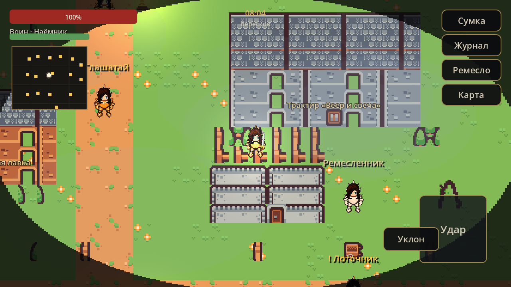
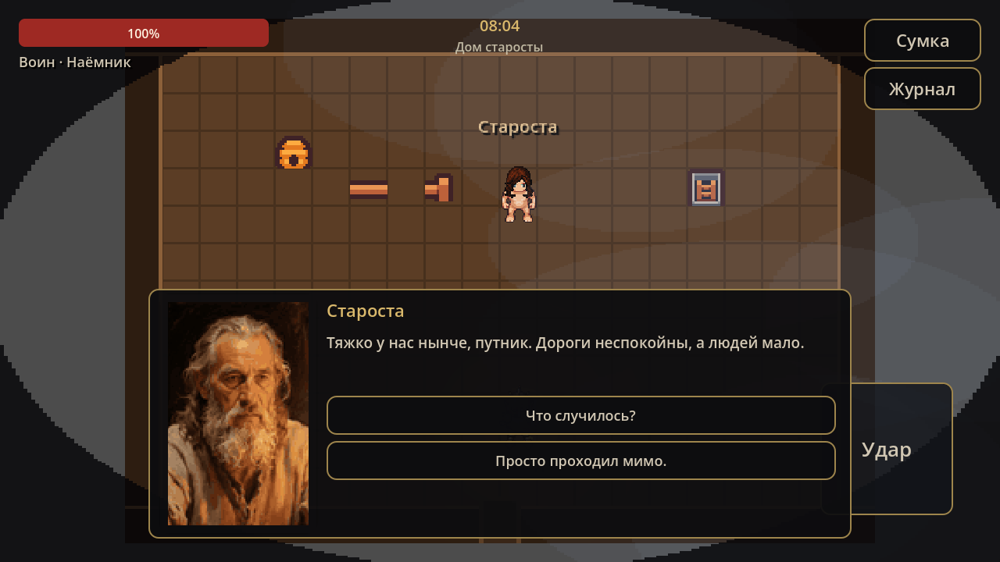
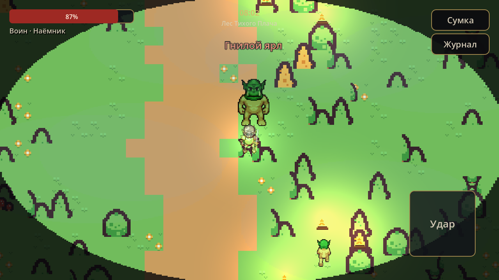
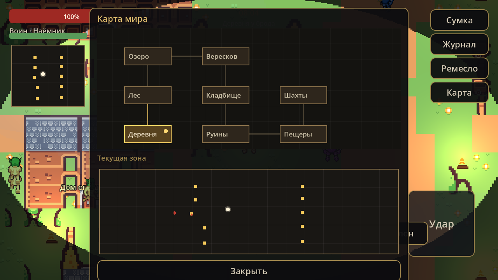
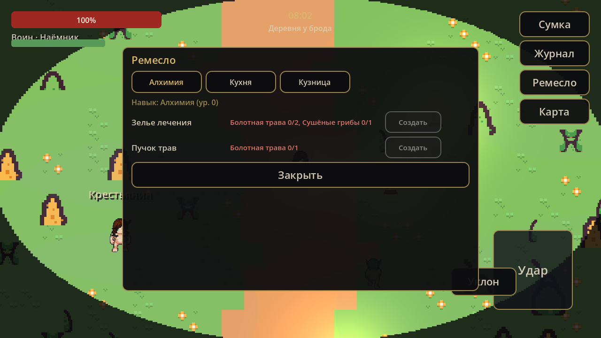
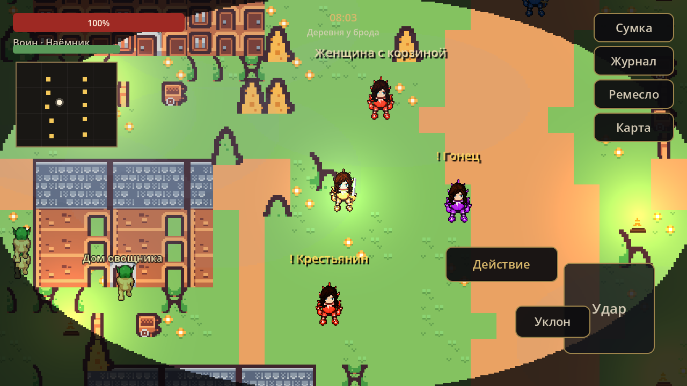

# The Dark RPG

2D экшен-RPG с видом сверху для Android. Тёмное фэнтези, открытые зоны, NPC с диалогами, квесты, торговля и ремесло.

Здесь выкладываются только готовые сборки (APK). Исходный код в этом репозитории не публикуется.

## Скачать

Последняя версия: **[Releases →](../../releases/latest)**

- `TheDarkRPG-debug.apk` — установить на телефон (Android 7.0 и новее, arm64 и armv7).
- Перед установкой разреши установку из браузера, если телефон спросит.
- Сохранения лежат в памяти приложения, при обновлении они остаются.

## Скриншоты

| Город Вересков | Диалог с портретом |
|---|---|
|  |  |

| Босс Гнилой ярл | Карта зоны |
|---|---|
|  |  |

| Ремесло | Деревня |
|---|---|
|  |  |

## Что уже есть

**Мир**
- 8 зон: деревня, лес, тихое озеро, город Вересков, старое кладбище, сгоревшие руины, пещеры, шахты.
- 16 зданий с интерьерами в городе и 10 в деревне, плюс застроенные кварталы.
- Смена дня и ночи, дождь, туман, свет костров.

**Бой**
- Ближний бой и стрельба из лука, выносливость, уклонение с неуязвимостью.
- Враги: гоблины, гоблины-стрелки, скелеты, культисты.
- Два босса: Гнилой ярл в лесу и Некромант Морн в руинах.

**Персонаж**
- 5 классов и 4 предыстории при создании героя.
- Экипировка с эффектом: оружие, броня, шлем; редкость предметов.
- Навыки растут от использования: клинки, стрельба, алхимия, кузница, выживание.

**NPC и квесты**
- Около 35 NPC с диалогами, портретами и разной внешностью.
- 25 квестов, включая основную сюжетную линию из 5 этапов.
- Торговля: у каждого торговца свой товар, цены зависят от отношения фракции.
- Репутация: деревня, город, гильдия.
- Уличные NPC патрулируют свои места, ночью возвращаются домой. Метки заданий над головами.

**Интерфейс**
- Сумка с экипировкой, журнал с квестами и навыками, карта зоны.
- Ремесло: алхимия, кухня, кузница.
- Три слота сохранений.

## Управление

- Джойстик слева — движение.
- «Удар» — атака.
- «Уклон» — рывок, тратит выносливость.
- «Действие» — разговор с NPC.
- «Сумка», «Журнал», «Ремесло», «Карта» — панели интерфейса.

## Планы

- Компаньон-наёмник, торговые караваны, случайные события на дорогах.
- Эффекты оружия: яд, горение, кровотечение.
- Больше зон и подземелий, расписание NPC по часам.
- Расширение озвучки и музыки.

## Технологии и лицензии

- Движок: Godot 4.6 (Compatibility), экспорт для Android.
- Тайлы и базовые спрайты: Kenney (CC0).
- Портреты, музыка и звуки созданы для проекта.

